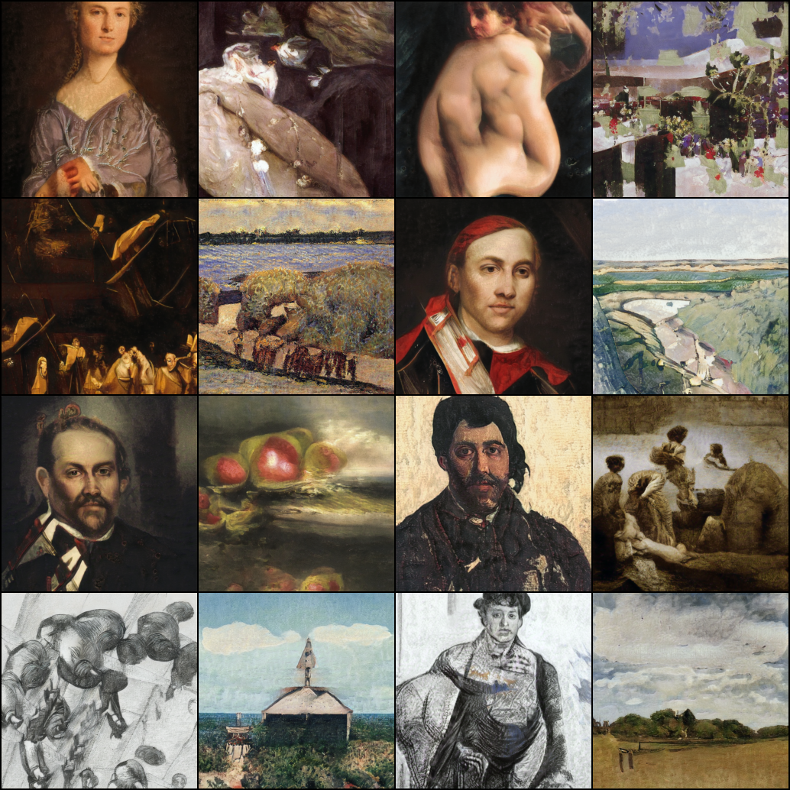
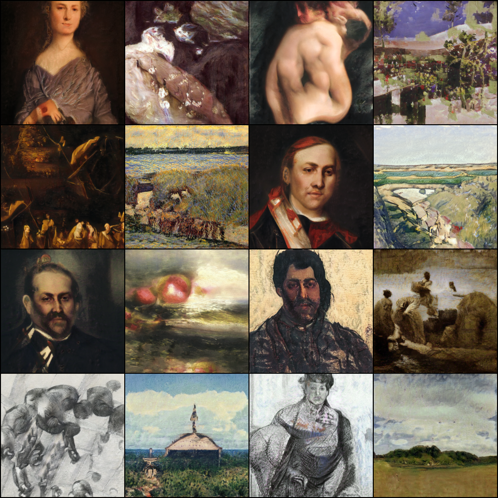
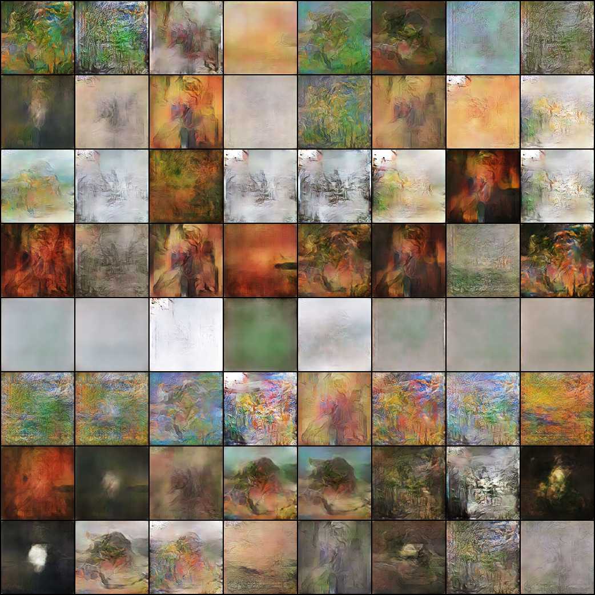
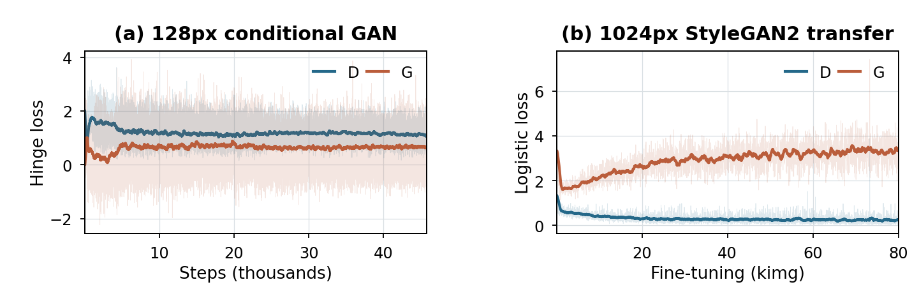

# Painting synthesis on full WikiArt

**Xinying Liu · ECE 285, Homework 2**

This project studies what a GAN trained on the assigned WikiArt dataset can learn from scratch, and how much a publicly pretrained high-resolution GAN changes when fine-tuned on the same collection. The final experiments index **81,444 paintings across 27 styles**. The work includes an independently implemented conditional GAN, a separate StyleGAN2-ADA transfer experiment, recorded training curves and generated samples, and a [NeurIPS-format report](report/homework2_wikiart_report.pdf). The [editable LaTeX project](latex/main.tex) is kept outside `report/` so that folder contains only the submission PDF.

## Results at a glance

| Experiment | Training data | Output | Pool3 FID ↓ | Inception Score ↑ |
| --- | ---: | ---: | ---: | ---: |
| Conditional GAN, trained from scratch | 73,300 paintings; 40 epochs | 128 × 128 | 177.32 | 2.405 |
| Public StyleGAN2 checkpoint, before our training | Public WikiArt pretraining | 1024 × 1024 | 55.97 | 7.019 |
| StyleGAN2 after our full-data fine-tuning | 73,299 paintings; 80.003 kimg | 1024 × 1024 | 58.12 | 7.080 |

Each row uses **1,000 real and 1,000 generated images** for the listed metrics. The two StyleGAN2 rows share a test split, generation seed, truncation setting, and preprocessing. Fine-tuning raises IS slightly but also raises FID by 2.15 points, so these measurements do not show an unqualified improvement. The scratch model uses a different resolution, conditioning scheme, and holdout split; its FID is useful context, not a controlled comparison with StyleGAN2. The [underlying metric files](results/) also record the PyTorch-Ignite tutorial's probability-feature FID, whose scale differs from pool3 FID.

## Generated paintings

The following grids are saved directly from the experiments. The public and fine-tuned StyleGAN2 panels use the **same 16 seeds and truncation $\psi=1$**; these examples are not hand-picked replacements for the metric sample.

| Public checkpoint | After fine-tuning |
| :---: | :---: |
|  |  |

The transfer model produces recognizable portraits, landscapes, and still lifes before and after fine-tuning. The visual differences are modest, consistent with its strong public starting point. The independently trained model captures color and painterly texture but frequently loses subject structure:

*Full generated grid from the independent 128px GAN.*

*Training losses across both completed runs. The objectives and vertical scales differ, so the curves should be interpreted within each model rather than compared by magnitude.*

## Experimental design

The scratch experiment uses a style-conditional convolutional generator and a spectrally normalized projection discriminator, optimized with a hinge adversarial loss. It completes 40 epochs and 45,800 updates at 128 × 128 resolution. The transfer experiment uses NVIDIA's unconditional StyleGAN2-ADA architecture initialized from [Peter Baylies's public WikiArt checkpoint](https://archive.org/details/wikiart-stylegan2-conditional-model). It trains at native 1024 × 1024 resolution, with R1 and path-length regularization, adaptive augmentation, and an exponential moving average of generator weights. The selected fine-tuned checkpoint is at 79.459 kimg; the run reaches 80.003 kimg and completes one traversal of its training partition.

The scratch run holds out 8,144 images. The transfer run has 4,072 validation and 4,073 test images; validation guides checkpoint selection, while the final before/after metrics use the test partition. Both FID variants and IS use the [PyTorch-Ignite evaluation approach](https://pytorch-ignite.ai/blog/gan-evaluation-with-fid-and-is/) with Inception-v3 and antialiased resizing to 299 × 299. Exact configurations, losses, split manifest, and metric JSON files accompany the figures in [`results/`](results/).

## Repository guide

| Path | Contents |
| --- | --- |
| [`report/`](report/) | Final PDF only: two pages of main text, references beginning on page three. |
| [`latex/`](latex/) | Editable `main.tex`, official NeurIPS 2026 style file, and figure assets. |
| [`full_wikiart/`](full_wikiart/) | Independent 128 × 128 conditional GAN: data preparation, model, training, evaluation, sampling. |
| [`stylegan2_transfer/`](stylegan2_transfer/) | Pretrained 1024 × 1024 experiment and [DataHub execution guide](stylegan2_transfer/RUNNING.md). |
| [`results/`](results/) | Recorded outputs for the two full-data experiments. |
| [`archive/`](archive/) | Earlier 64 × 64 trials, Kaggle notebooks, and the superseded report generator. |
| [`tools/`](tools/) | Reproducible utilities for the loss plot and generated-example figure. |

The current report and figures use the **full-data experiments**. The earlier 2,390-image trials are preserved under `archive/` for provenance and are not presented as full-dataset results.

## Interpretation

The public checkpoint was itself trained on WikiArt, and its original image list is not available here. It may overlap with paintings in this project's validation or test split. Consequently, the transfer scores describe this run but **cannot establish generalization to images unseen during public pretraining**. FID and IS are finite-sample estimates based on an ImageNet classifier; they are imperfect measures of painting quality and diversity. The report discusses these limits alongside the quantitative and visual evidence.

For exact reproduction details, see the [full-data model notes](full_wikiart/README.md), [transfer model notes](stylegan2_transfer/README.md), and the [DataHub guide](stylegan2_transfer/RUNNING.md). The 1024px public weights are credited in [`stylegan2_transfer/UPSTREAM.json`](stylegan2_transfer/UPSTREAM.json).
